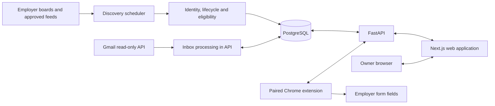

# ACE

ACE is a private career web application for discovering relevant engineering roles, managing applications, reviewing recruiting email and maintaining resume knowledge. Its current interface is the Wine and Rose platform, with Day and Night themes.

**Live website: [ace.opik.net](https://ace.opik.net)**. The public home page introduces the product; the workspace requires the owner's sign-in. ACE is a single-owner application with no public registration.

## Daily workflow

1. **Pulls** shows discovery activity in fifteen-minute windows, including quiet checks, new opportunities and source health. A Pull window is a display grouping, not a universal polling schedule.
2. **Opportunities** provides searchable, paginated roles with combined sorts, company and source filters, experience evidence, explainable resume matches and official application links. Open a posting, review it and apply on the employer's website.
3. **Applications** keeps submitted history, stages, dates and notes, including records without a stored posting. Explicit application actions persist across views and tabs; CSV export is available.
4. **Inbox Intelligence** reads an independently authorized Gmail connection, separates acknowledgements, decisions and hiring actions, and explains what was filed or needs review. Review, correction, email viewing and Undo preserve the evidence trail.
5. **Analytics** brings together submission activity, current statuses, historical outcomes, role breakdowns and company evidence, with filters and links to the underlying application records.

**ACE never submits an employer application or marks it Applied merely because it filled a form.** The owner reviews and submits on the employer site and records the application separately.

## Features

| Area | Current capabilities |
| --- | --- |
| Discovery | ATS and official-site readers, approved feeds, stable posting identities, lifecycle history and a versioned eligibility gate. Per-source intervals and refusal backoff govern polling. |
| Resume matching | Deterministic lexical matching with related-skill credit and visible matched, missing and insufficient-evidence states. Scores rank eligible roles; they do not decide eligibility. |
| Resume Studio | Original document uploads and PDF previews, document/version library, primary resume selection, reviewed career facts, deterministic compatibility checks and assessment history. |
| Autofill Extension | Paired Chrome Manifest V3 extension, explicit Fill or Alt+A, supported native/custom controls, repeating work and education history, answer reuse, correction and Undo. |
| Answers | Editable answer bank and work/education history, plus private extension Memory with context-sensitive reuse and edit/delete controls. Employer-motivation answers stay on the employer form. |
| Archive | Reviewed and dismissed postings remain accessible separately from the daily opportunity list. Saved postings retain their supporting route. |
| Coverage | Source reachability, coverage gaps and employer/source discovery controls. Unsupported and refused sources remain visible limitations. |
| Settings | Day/Night/System theme, owner profile, account/session security, operational information and owner-data exports. |

Resume Studio reports **estimated ACE compatibility**, not an employer ATS score. Automatic resume tailoring and template-based DOCX/PDF export remain future work.

## Architecture



Next.js uses authenticated server reads and a same-origin API proxy. FastAPI owns authorization and user mutations. The scheduler owns discovery writes. PostgreSQL stores applications, evidence, answers, resumes and source history. Gmail processing runs within the API independently of the discovery scheduler. Caddy provides production HTTPS.

The default eligibility profile targets US full-time early-career software, ML and forward deployed engineering roles. Missing sponsorship information is unknown, not a rejection. Source coverage is incomplete, and providers may refuse access; ACE respects those refusals.

## Repository

```text
backend/app/          FastAPI, domain logic, readers, scheduler, Inbox and Studio
backend/migrations/   Alembic schema history
backend/scripts/      Explicit maintenance, audit and demo commands
backend/tests/        Backend and extension browser tests
web/src/              Next.js routes, shared components and client state
web/tests/            DOM, calculation and Playwright checks
extension/            Unpacked Chrome Manifest V3 extension and matcher tests
deploy/oracle/        Production Compose, HTTPS and backup tooling
scripts/              Repository validation helpers
docs/                 Runbooks, architecture and dated engineering records
ACE_NEXT_KNOWLEDGE.md  Authoritative cross-session continuity
```

`main` is the canonical platform branch. Legacy source is recoverable through `legacy-main-final`; private data archives are maintained outside the repository.

## Local setup

Prerequisites: Python 3.12 with venv support, Node.js 22 with npm, and Git. PostgreSQL 16 and Docker Compose are needed for a persistent container-based environment, but the fictional demo below uses SQLite and starts no discovery scheduler.

From a fresh checkout:

```bash
git clone --branch main https://github.com/anwarbuilds/ace.git ace-next
cd ace-next
python3.12 -m venv .venv
.venv/bin/python -m pip install -r backend/requirements.txt
cp .env.example .env
chmod 600 .env
cd web
npm ci
cd ..
```

Use a fresh `.env` containing example values for the demo. Do not copy a production configuration into it. The seed command replaces its target database; use only this fictional database:

```bash
.venv/bin/python -m backend.scripts.seed_demo --database-url sqlite:///ace-demo.db
ACE_DEMO_COMPANIES=1 DATABASE_URL=sqlite:///ace-demo.db \
  RESEND_API_KEY= ALERT_EMAIL= REQUIRE_LOGIN_EMAIL_CODE=false \
  WEB_BASE_URL=http://localhost:3000 \
  .venv/bin/python -m uvicorn backend.app.api.main:app --host 127.0.0.1 --port 8000
```

In another terminal:

```bash
cd ace-next/web
API_ORIGIN=http://127.0.0.1:8000 npm run dev
```

Open [localhost:3000](http://localhost:3000) and sign in with the fictional credentials printed by the seed command. For a local production build, run `npm run build`, then `API_ORIGIN=http://127.0.0.1:8000 npm start` from `web/`.

The persistent Compose environment is described in the [operations runbook](deploy/oracle/README.md#local-persistent-development). Give development its own database and Compose project. Never point demo seeding or browser mutation tests at real records or a recovery database.

## Configuration

The backend reads environment variables and the local `.env`; Next.js reads `API_ORIGIN`. Start from [.env.example](.env.example), or the separate [production template](deploy/oracle/.env.example). Values below are examples only.

| Category | Settings |
| --- | --- |
| Storage | `DATABASE_URL=sqlite:///ace-demo.db` for the demo; `ACE_DB_NAME`, `ACE_DB_USER`, `ACE_DB_PASSWORD` and `ACE_DB_PORT` for local PostgreSQL. |
| Website/auth | `WEB_BASE_URL=http://localhost:3000`, `PUBLIC_BASE_URL`, `ACE_AUTH=required`, private `SETUP_TOKEN`, `SESSION_DAYS`, `REQUIRE_LOGIN_EMAIL_CODE`. |
| Web-to-API | `API_ORIGIN=http://127.0.0.1:8000` locally; internal service origin in Compose. |
| Google sign-in | Optional `GOOGLE_CLIENT_ID`, `GOOGLE_CLIENT_SECRET`, `GOOGLE_REDIRECT_URI`. This does not connect Gmail. |
| Gmail | Separate `GMAIL_CLIENT_ID`, `GMAIL_CLIENT_SECRET`, `GMAIL_REDIRECT_URI`, private `GMAIL_TOKEN_KEY`; `GMAIL_BACKGROUND_SYNC_ENABLED`, `GMAIL_AUTO_REJECTIONS`, `GMAIL_AUTO_OUTCOMES_ALLOWED`. |
| Discovery/display | `ACE_TARGET_PROFILE`, `DISPLAY_TIMEZONE=America/Los_Angeles`, `MAX_ALERT_POSTING_AGE_DAYS`, `ALERT_ON_UNKNOWN_POSTING_AGE`; source-specific polling intervals are stored in the catalog. |
| Optional email | `RESEND_API_KEY`, `MAIL_FROM`, `ALERT_EMAIL`. Delivery is unavailable until configured. |
| Operations | `API_DOCS=false`; production domain, backup and release settings are documented in the runbook. |

Keep `GMAIL_HISTORICAL_RECHECKS_ENABLED=false` unless a specific historical operation has been approved. Sign-in, Gmail consent, email delivery and status automation are separate configuration decisions.

## Development and verification

Run relevant checks against isolated fictional fixtures:

```bash
.venv/bin/python -m pytest backend/tests -q --ignore=backend/tests/browser
node extension/test-rules.js
node extension/test-memory.js
python3 scripts/no_user_facing_dashes.py
cd web
npm run test:extension-dom
npm run test:company-logos
npm run test:inbox
node --test tests/analytics-calculations.test.mjs
npx next typegen
npm run typecheck
npm run lint -- src tests
npm run build
```

Playwright and the Python extension browser suite require Chrome/Chromium, extra browser dependencies and fictional services. Follow the [testing runbook](docs/operations/testing.md); do not run them against the live website. Local Chrome runs on the owner's laptop remain suspended because of its documented cooling problem. Hosted CI runs the browser checks.

Main pushes and pull requests run CI. Check the [actual workflow results](https://github.com/anwarbuilds/ace/actions/workflows/ci.yml); there is no permanent all-tests-passing claim. Known browser failures and exact verification limits are recorded in the [current handoff](docs/HANDOFF.md).

## Production and data handling

Production runs at [ace.opik.net](https://ace.opik.net). **Pushing source does not deploy it.** Releases require explicit approval for the exact operation, verified private backups, retained rollback images and checks against the running services. API, web and scheduler may intentionally run different tested revisions. A branch rename or documentation push does not require rebuilding them. See the [deployment runbook](deploy/oracle/README.md).

Owner data requires authentication; extension tokens have limited scopes. Gmail consent is read-only and separate from owner sign-in. The email viewer rebuilds allowed HTML, blocks remote images and runs without email scripts. Real resumes, answers, mail, screenshots, credentials and database dumps belong only in private storage, never in commits or public artifacts.

Inbox classification, application matching and permission to change status are independent decisions. Recognized unlinked email evidence is not a confirmed application-stage event; company-level rejection evidence does not reject every application at that employer. Assessment/interview history survives a later rejection. Owner decisions, corrections and Undo remain authoritative.

Classification is imperfect, source coverage is incomplete and a connected mailbox does not prove complete observation. Analytics does not infer historical submitted resumes, application channels or response rates without supporting records. Historical sponsorship evidence does not establish that a current role sponsors. Backups on the production VM alone do not protect against loss of that VM.

## Project status and documentation

The Wine and Rose web platform is in daily use. Discovery, applications, Inbox Intelligence, Analytics, Resume Studio and the paired extension are implemented. Remaining limitations include provider coverage, unmeasured population classification accuracy, missing historical attribution and the unfinished resume-tailoring/export workflow.

- [Current handoff](docs/HANDOFF.md): current layout, runtime revisions, CI limits and next-session instructions.
- [Global continuity](ACE_NEXT_KNOWLEDGE.md): authoritative decisions and dated production evidence. Read it completely before repository changes.
- [Knowledge index](docs/knowledge/README.md): subsystem history and engineering contracts.
- [Analytics metric sources](docs/analytics/metric-sources.md): definitions, evidence requirements and unavailable states.
- [Production operations](deploy/oracle/README.md) and [testing](docs/operations/testing.md).
- [Consolidation and recovery](docs/operations/platform-consolidation-2026-10-30.md): branch archive, local retirement and private recovery instructions.
